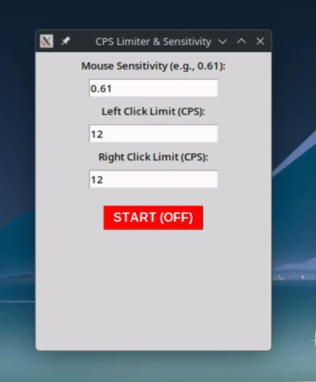

# CPS Limiter & Sensitivity (Linux)

A lightweight,open-source, precise CPS (Clicks Per Second) limiter and mouse sensitivity adjuster for Linux, designed primarily for Gamers.



## Features
- Limits Left and Right Click CPS independently.
- Adjusts mouse sensitivity (e.g., 0.61) without pixel skipping.
- Works at the hardware level (`evdev`).
- Runs in the background with a simple GUI.

## Prerequisites
- Linux (X11 or Wayland)
- Python 3
- `python-evdev` installed (`sudo pacman -S python-evdev` on Arch/Manjaro)

## Installation

```bash
**1. Build the Executable:**

pip install pyinstaller --break-system-packages

Then, compile the script into a single executable:

pyinstaller --onefile --noconsole --hidden-import=evdev --hidden-import=evdev.ecodes cps_limiter.py

2. Move the Executable:
Move the compiled binary to your local bin directory so all users can access it:

sudo mv dist/cps_limiter /usr/local/bin/
sudo chmod +x /usr/local/bin/cps_limiter

3. Install Polkit Policy (Required for GUI root access):
Copy the policy file so the app can ask for a password graphically:

sudo cp com.github.cpslimiter.policy /usr/share/polkit-1/actions/

4. Install Desktop Shortcut:
Copy the shortcut file so it appears in your application menu:

sudo cp cps-limiter.desktop /usr/share/applications/

5. Update Application Menu:

kbuildsycoca6

Usage

    Open "CPS Limiter" from your application menu.

    Enter your desired Mouse Sensitivity (e.g., 0.61).

    Enter Left and Right CPS limits (e.g., 12).

    Click START.

Note: The application will prompt for your root password to access the /dev/input/ devices

## Quick Install (Pre-compiled Binary)
If you don't want to build from source, you can download the ready-to-use executable directly from the **[Releases](https://github.com/qqqn/cps-limiter-linux/releases)** page.

1. Download the `cps_limiter` file.
2. Open your terminal and make it executable:
```bash
chmod +x ~/Downloads/cps_limiter
sudo mv ~/Downloads/cps_limiter /usr/local/bin/
3.(Optional but recommended) Install the Polkit policy and Desktop shortcut so it works with a single click as described in steps 3 & 4 below.
